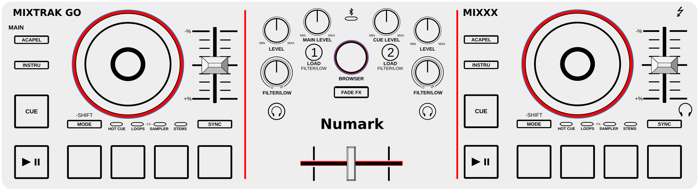
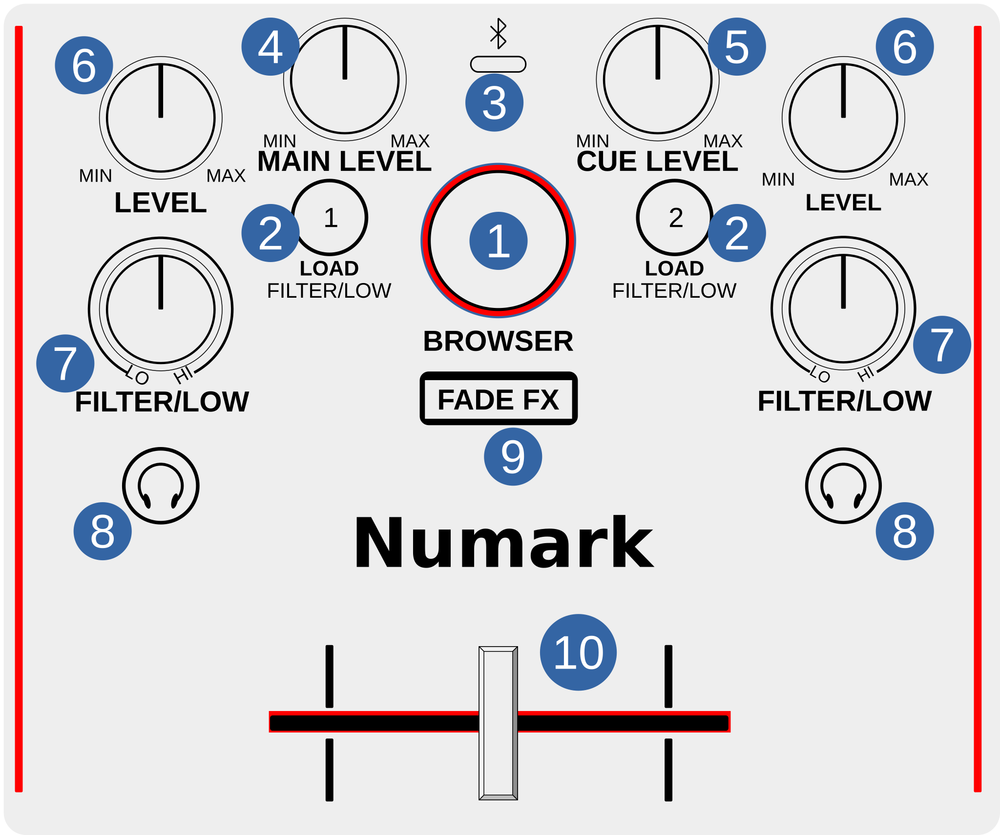
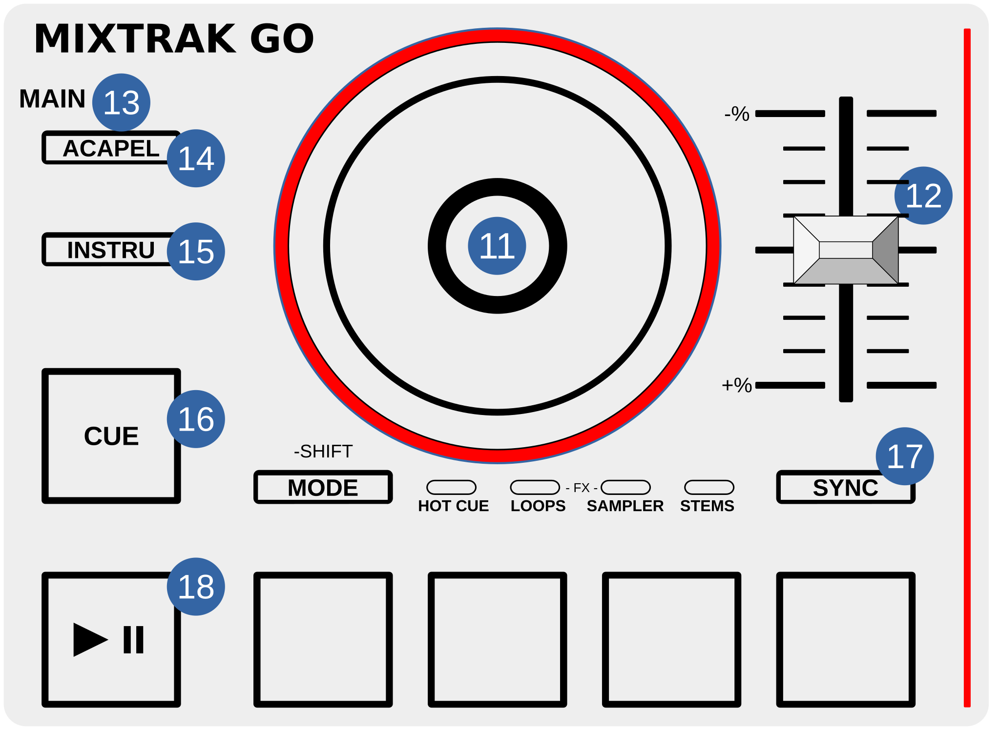
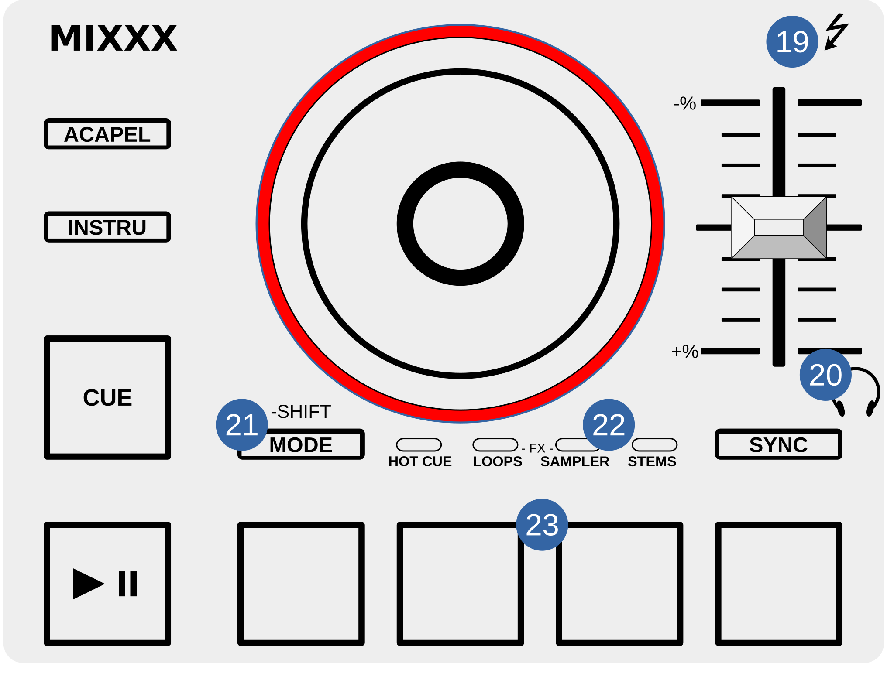

This repository holds the mapping files for the Mixtrack Go.
In principle, the files here will be updated with potential bug corrections or added features ahead and independently of their inclusion in a Mixxx release.

To use this mapping, put both **Numark-Mixtrack-Go.midi.xml** and **Numark-Mixtrack-Go.scripts.js** in the Controllers directory.
See Preferences -> Library -> Setting Directory -> Open Mixxx Settings Folder.

Branches:
 - **main** — upstream-derived baseline.
 - **enhanced** — community enhancements proposed for upstream review; not an official release.

**Enhanced mapping files (current branch):** right click + Save Link As
 - [Numark-Mixtrack-Go.midi.xml](https://raw.githubusercontent.com/paurock/Numark-Mixtrack-Go-mapping-for-Mixxx/enhanced/Numark-Mixtrack-Go.midi.xml)
 - [Numark-Mixtrack-Go.scripts.js](https://raw.githubusercontent.com/paurock/Numark-Mixtrack-Go-mapping-for-Mixxx/enhanced/Numark-Mixtrack-Go.scripts.js)

**Start here:** [Enhanced control reference and installation guide](ENHANCED_README.md) · [Changelog](CHANGELOG.md). Both mapping files must be installed together. This branch is a review candidate and has not passed full hardware regression testing.

**Original upstream:** [josefveiga/Numark-Mixtrack-Go-mapping-for-Mixxx](https://github.com/josefveiga/Numark-Mixtrack-Go-mapping-for-Mixxx). The original author's alpha branch may contain other changes; the links above intentionally target our `enhanced` branch.

# Numark Mixtrack Go


**Numark Mixtrack Go** is a USB [MIDI](https://manual.mixxx.org/2.5/en/glossary#term-MIDI) controller with an integrated audio interface.
It improves on the concept of the Numark DJ2GO2 Touch by adding:

- STEMS tracks support - the STEMS support in [Mixxx](https://mixxx.org/download/) is added on version 2.6.
- Shifting - now some buttons have alternate actions if pressed while shifted.
- Mode selection is independent for each deck.
- Better LED feedback.
- More controls.

Useful links:
- [Numark Mixtrack Go website](https://www.numark.com/new/mixtrack-go/)
- [Mixxx forum thread for this mapping](https://mixxx.discourse.group/t/numark-mixtrack-go-mapping/34099)

The Numark Mixtrack Go controller is a USB Audio and MIDI Class compliant device and works with Linux, macOS, and Windows.


## Soundcard Setup

This controller has a built-in 4 channel output sound card, with a stereo Main output (3.5mm jack) and stereo Headphone output (3.5mm jack).

- To configure the controller's sound card:
   - Open **Options** > **Preferences** > **Sound Hardware**
   - Select the **Output** tab.
   - From the **Main** drop-down menu, select the audio interface, then **Channels 1-2**.
   - From the **Headphones** drop-down menu, select the audio interface, then **Channels 3-4**.
   - Click **Apply** to save the changes.


## Mapping Settings

This mapping allows for some user settings.

To configure settings:
- Go to **Options** > **Preferences** > **Controllers**
- Select **Numark Mixtrack Go** > **confirm this mapping is loaded**
- Choose your personalized settings on the **Mapping Settings** tab.

Available user settings:

- Jog Wheel
    - Pitch Bend Sharpness
       - a finer sharpness is more suitable for fine tuning the beatmatching when using sync with grid aligned tracks.
       - a more coarse option is better suited for faster manual beatmatching.
    - Seek Speed (top touch when deck is stopped)
       - set the speed to stripsearch a track when the deck is stopped.
       - the default value is 1 (same as scratch speed).
    - Vinyl Mode Default State On
       - check this box for the Vinyl Mode to be activated from the start.
- Initial LEDs State
     - Initial LEDs Setting Delay.
       - select a delay in seconds for the LEDs to be set (default is 1s).
       - this delay should be long enough for the lightshow termination to finish.


### Optional Auto Next (Deck 1)

In **Mapping Settings → Auto Next**, enable `Enable Auto Next on Deck 1`, then set `Auto Next Delay (seconds)` from 0 to 30 (default 3). After the left-deck song ends naturally, the mapping waits the configured delay, then attempts to load and play the next highlighted-library track. It is **off by default**, does not engage Auto DJ and does not modify Deck 2. The next track is chosen relative to the **highlighted library row**, not by automatically finding the currently loaded track in the playlist. See the [enhanced guide](ENHANCED_README.md#optional-auto-next-deck-1-only) for limitations and the testing checklist.

## Controller Layout

- The Numark Mixtrack Go's layout has 3 sections:
  - The middle holds the mixer related controls, library browsing and track loading controls.
  - On each side there is a deck control area, where in Mixxx the left deck control will control Deck 1 and the right deck will control Deck 2.
  - Both decks have essentially the same controls each. What differs is that the left side also has the connector to the Main Output and on the right side there's both a USB-C plug and Headphones connector.




## Mixer Area Layout



| Number | Control        | Function |
| ------ | --------       | -------- |
| 1      | Browser        | Navigate the library; press to toggle Preview, rotate while previewing to seek; Shift + press changes library focus. See enhanced guide. |
| 2      | Load           | Short press loads the selected track on release; 1-second hold ejects when playback is stopped. |
| -      | Shift Load1    | Switches the filter/low knobs between controlling the Low EQ and the Filter (or any other) Effect. |
| -      | Shift Load2    | Toggles the Vinyl mode in the Jogwheel. |
| 3      | Bluetooth      | There is currently no functionality for this LED in Mixxx. |
| 4      | Main Level     | Controls the Main Output Gain. |
| 5      | Cue Level      | Controls the Headphone Gain. |
| 6      | Level          | Controls each channel's Volume. |
| 7      | Filter/Low     | Controls the Quick Effect currently selected for that channel, or the Low EQ. Use Shift + Load 1 to switch between the Effect and Low EQ. Select the Effect in the Mixxx graphical interface. |
| 8      | Headphone      | Sends that channel's audio through the Headphone Output. |
| 9      | Fade FX        | This button toggles the Fade FX feature in Mixxx. When Fade FX is active, moving the Crossfader away from the current deck will activate the Quick Effect of that deck. When inactive, the Crossfader will work normally. |
| 10      | Crossfader    | Fades between the Left and the Right channel. |

```{note}
   - While Fade FX can use any effect available on each channel, effects that don't have their reset point at 0
     (when the knob is turned all the way to the left), may not work as expected.
   - These effects currently are:
       - Filter Echo
       - Mid/Side
       - Balance
       - Filter
       - Loudness
       - Moog Filter
       - Pitch Shift
```

## Deck Area Layout




| Number | Control            | Function |
| -------| ------------------ | ---------|
|11      | JogWheel           | If Vinyl Mode is active, the top surface controls scratching and the side surface controls Pitch Bend. If Vinyl Mode is inactive, both surfaces control pitch bend. Use Shift + Load 2 to toggle. |
|12      | Tempo Fader        | Changes the track's playback speed. |
|13      | Main Audio Output  | Connect this output to an amplifier or speaker system. This main out put volume is controlled by the Level knob. |
|14      | Acapel             | The Acappella button activates an acappella from the loaded track. This is a STEMS button. |
|15      | Instru             | The Instrumental button activates an instrumental from the loaded track. This is a STEMS button. |
|16      | Cue                | Sets the cue point or moves to the main cue point and stops. See options at **Preferences** > **Deck** > **Cue mode**. |
| -      | Shift Cue          | Moves to the main cue point and resumes playing from there. |
| -      | Shift Cue(2x)      | Loads the previous track on the Library and starts playing it from the main cue point. This action is prevented if **Preferences** > **Deck** > **Loading a track, when a deck is playing** is set to Reject. |
|17      | Sync               | Long Press to activate Sync Lock. Tap to trigger beat sync (syncs tempo and phase). |
|18      | Play/Pause         | 1.5-second fade-in when starting and fade-out before pausing; uses software channel volume. |
| -      | Shift + Play/Pause | Moves to the main cue point and resumes playing from there. Same as Shift + Cue. |

```{note}
   Acapel and Instru functions require a STEMS track to be loaded and a MIXXX version 2.6 or higher.
```



| Number     | Control            | Function |
| ---------- | -------------------| ---------|
| 19         | USB-C Port         | This port serves as both source of power and data transfer to and from your computer or other device. |
| 20         | Headphone Output   | Connect headphones to this 1/8” (3.5 mm) jack for monitoring a channel. The headphone volume is controlled using the Cue Level knob. |
| 21         | Mode (**Shift**)   | Press this button to change the current function of the Performance Pads. A long press activates the **SHIFT** functions on other controls. |
| 22         | Mode Leds          | These LEDs highlight the current pad mode. The modes cycle in the order HOT CUE->LOOPS->FX->SAMPLER->STEMS. The FX mode is activated when both the LOOPS and the SAMPLER LEDs are highlighted. |
| 23         | Pads               | Performance Pads: These pads can be used to trigger Hotcues, Loops, Samples, Stems, and to apply effects. To change the function of the pads, press MODE. |
| -          | **Hotcue Mode**    | In Hotcue Mode, a Pad sets a hotcue in the current position of the track. Shift + Pad clears the corresponding hotcue. |
| -          | **Loops Mode**     | Pads toggle their selected beatloop lengths (1, 2, 4, 8 beats by default). Additional selectable presets are described in the enhanced guide. |
| -          | **FX Mode**        | Pads 1–3 momentarily enable Echo, Flanger, and Reverb; Pad 4 momentarily enables 1-beat Beat Roll. Release to stop the effect. |
| -          | **Sampler Mode**   | Samples are loaded manually in Mixxx. Short Pad press retriggers the sample from the beginning and performs one-shot Beat Sync (tempo and phase) without Sync Lock. Holding Pad for 1 second stops the sample without unloading. Shift + Pad does nothing; Left deck pads control Samplers 1–4, right deck pads control Samplers 5–8. Shift + SYNC on either deck toggles continuous synchronization for all eight sampler slots. |
| -          | **STEMS mode**     | In STEMS Mode, pads mute and unmute the components of the loaded STEMS track: Pad1 affects the Drums stem part, Pad2 affects the FX/Bass stem part, Pad3 affects the Synth stem part and Pad4 affects the Voice stem part. |

```{note}
   STEMS mode functionality requires a STEMS track to be loaded and a MIXXX version 2.6 or higher.
```
